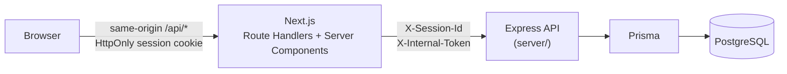

# Architecture

## Overview

North & Form is a fictional e-commerce showcase. The Next.js storefront acts as a
server-side proxy (BFF) for an Express REST API, which stores all commerce data in
PostgreSQL through Prisma. The browser only talks to the storefront.

## Frontend (`src/`)

- **Next.js App Router, React, TypeScript, Tailwind CSS.**
- **Pages** are Server Components rendered per request. Catalogue, product, payment,
  order and orders pages read data through the server services in `src/server/api/`.
- **Route Handlers** (`src/app/api/**/route.ts`) keep the storefront's original URLs and
  response envelopes. Each is a few lines: validate input with Zod, call a service, return JSON.
  The shared `route()` wrapper (`src/app/api/_lib/route.ts`) handles the session cookie,
  same-origin checks, the JSON body limit and error mapping.
- **Services** (`src/server/api/products|cart|orders|payments.ts`) map storefront operations to
  Express endpoints. `client.ts` centralises the base URL, headers, JSON, 5 s timeout and error
  normalisation. Responses are validated against the storefront's existing Zod schemas.
- **Client components** use TanStack Query for server data and a small Zustand store for checkout UI state.

## Backend (`server/`)

- **Express 5 + TypeScript**, layered as:
  - `routes/`: HTTP routing only
  - `schemas/`: Zod request validation
  - `services/`: business logic (pricing, cart, vouchers, orders, payments, sessions)
  - `dto/`: database rows → API response shapes
  - `middleware/`: session header, internal token, central error handler
  - `db/`: Prisma Client (PostgreSQL adapter) and an idempotent seed
- **Prisma ORM** with migrations; PostgreSQL 17 runs locally via Docker Compose.
- **Data model:** products, guest sessions, carts, cart items, vouchers, orders, order items,
  payment transactions. Money is stored as integer cents.
- **API documentation:** OpenAPI 3.0.3, served by Swagger UI at `/api-docs` and as `/openapi.json`.

## Request flow: fetching products

1. The browser requests `/products` (page) or `GET /api/products` (JSON).
2. The page or Route Handler calls `getProducts()` in `src/server/api/products.ts`.
3. `apiRequest()` calls Express `GET /api/products` with the configured `COMMERCE_SERVER_URL`.
4. Express reads the products from PostgreSQL via Prisma and returns them in catalogue order.
5. Next.js validates the response and renders the page or returns the JSON unchanged.

If Express is unavailable, the storefront returns 502 (503 if `COMMERCE_SERVER_URL` is unset).
There is no local fallback data.

## State management

| State | Owner |
|---|---|
| Products, carts, orders, payments | **PostgreSQL** (single source of truth) |
| Server data in the browser | **TanStack Query** cache, e.g. the cart under `['cart', 'en-GB']` |
| Checkout UI state (selected payment method) | **Zustand** `useCheckoutStore`, persisted in `localStorage` |

- The cart page, checkout, payment step and header cart link share one cart query.
- Mutations are not optimistic: after the API confirms a change, the cart query is invalidated and
  refetched, so every view, including the header item count, shows the server state.
- Client-side navigation reuses the cache. A page refresh refetches the cart; the session cookie
  makes it the same cart.

## Checkout

- **Cart:** add, change quantity, remove and empty. Lines merge by product; quantity is 1–99 and
  checked against availability and stock. All totals are calculated on the server.
- **Vouchers:** stored in the database; `DEMO10` gives 10 % off. Unknown, inactive or expired
  codes are rejected.
- **Orders:** a guest form (validated in the storefront and in Express) creates an order from the
  cart. The order snapshots products, prices, totals and customer details, then the cart is
  emptied. Idempotency keys prevent duplicate orders.
- **Payments (simulated only):** the shopper picks a successful or declined outcome. Every attempt is
  stored. Declined payments can be retried, an authorised order is never charged again, and
  payment keys are idempotent. No card data is accepted or stored.

## Security

- **Guest sessions:** a random UUID in an HttpOnly, SameSite=Lax cookie (Secure over HTTPS),
  forwarded to Express as `X-Session-Id`. Malformed values start a new session. The cart ID
  exposed to the browser is never the session ID.
- **Isolation:** carts and orders are scoped to the session; other sessions get 404.
- **Internal token:** `INTERNAL_API_TOKEN` is sent only server-to-server (`X-Internal-Token`) and
  never reaches the browser. Express refuses to start without it in production or on a
  non-loopback address. The product catalogue stays public.
- **Request hardening:** same-origin checks for mutations, 16 KB JSON limit, Zod validation at both
  layers, server-calculated prices (client totals are ignored), generic 500 responses without
  internal details.

## Testing

- **Storefront (Vitest):** Route Handler contracts and the Next → Express mapping against a fake
  backend, component tests for cart, checkout and payment UI, and checkout validation.
- **Backend (Vitest + Supertest):** runs against a real PostgreSQL test database whose name must end
  in `_test`. Covers products, cart, vouchers, orders, payments, sessions, security, persistence
  across restarts and pricing.
- **API contract:** OpenAPI document validation; real responses are checked against the documented schemas.
- **End-to-end (Playwright):** the full shopping journey, cart behaviour and accessibility checks
  (axe), running through Next.js, Express and PostgreSQL on desktop and mobile Chromium.
- **CI (GitHub Actions):** formatting, lint, typecheck, unit and backend tests with a PostgreSQL
  service, builds and E2E.

## Known limitations

- Stock is validated per cart and order but not reserved or decremented.
- Cart lines are addressed by position (`entryNumber`), as in the original storefront contract.
- Customer validation rules exist in both the storefront and Express and must be kept in sync
  (postal-code rules are checked for parity by a test).
- City and country consistency is enforced through country-specific postal-code formats, not a
  city database.
- Guest orders are reachable only while the session cookie exists. Idle carts are cleared after
  24 hours; orders are kept.
- Demo limits: 50 orders per session and 20 payment attempts per order.
- Not-found pages are rendered with HTTP status 200 because of streaming.
- The Dockerfile builds the storefront only; Express and PostgreSQL are deployed separately.
- The checkout Zustand store contains fields that are written but not read.
